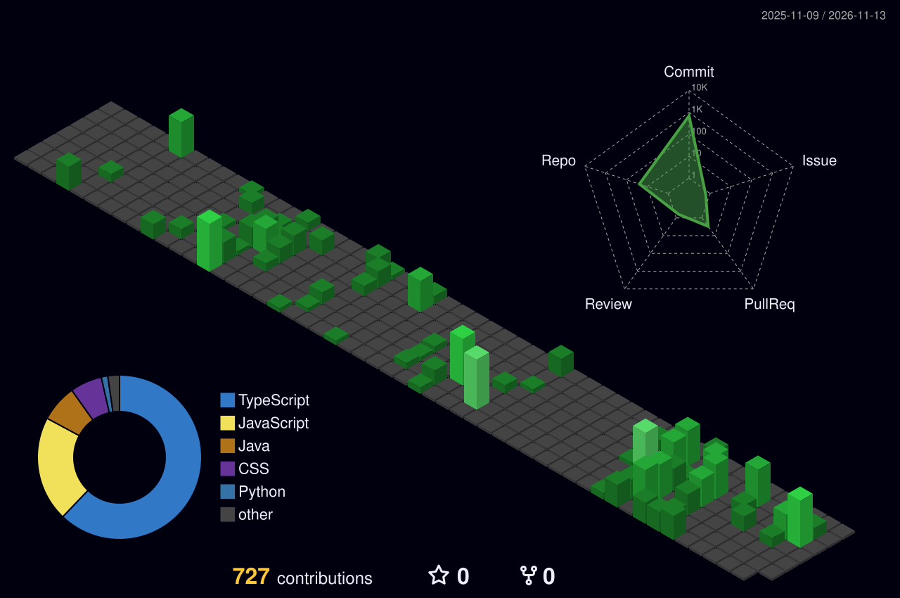
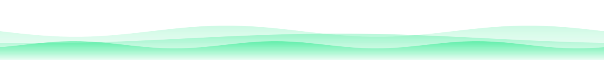

  

  
  &nbsp;
  
  &nbsp;
  

I build web applications end-to-end with modern TypeScript, Spring Boot, and cloud databases. 
Currently diving deep into **AI agent systems, backend architectures, and open-source tooling**. 
Flagship build: [**RepoGuide**](https://github.com/anurag2417/RepoGuide) — an AI copilot that guides developers through their first open source contribution.

<code><b>&lt;Languages &amp; Core /&gt;</b></code> 

  

<code><b>&lt;Frontend &amp; Frameworks /&gt;</b></code> 

  

<code><b>&lt;Backend &amp; Databases /&gt;</b></code> 

  

<code><b>&lt;DevOps, Cloud &amp; Tools /&gt;</b></code> 

  

  

&nbsp;

  

 

&nbsp;&nbsp;

  

💬 *Open to collaborating on **full-stack web apps, AI copilot tooling, and open-source projects**.*

 

